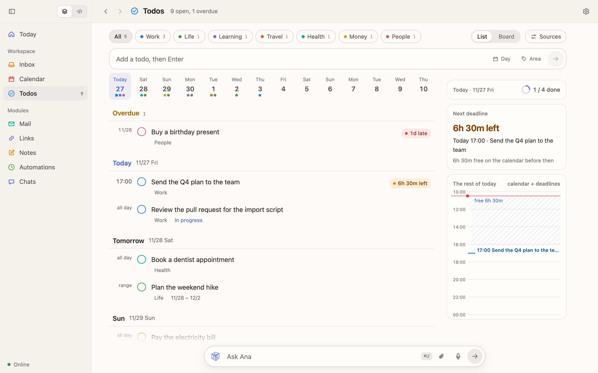
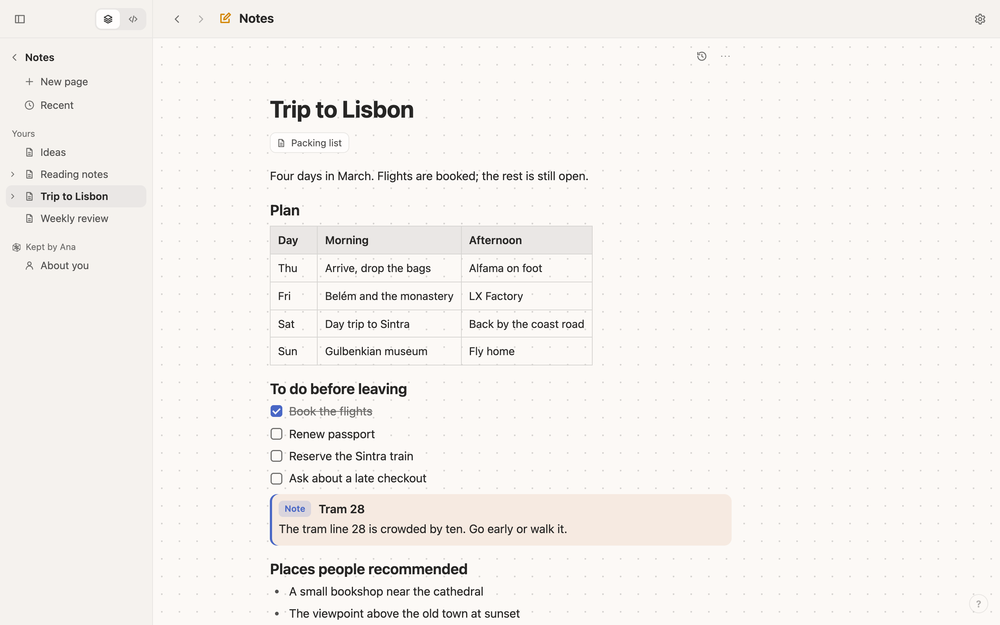
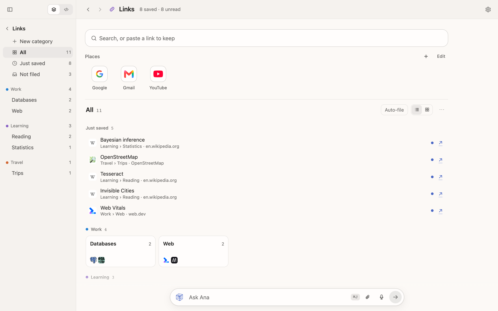
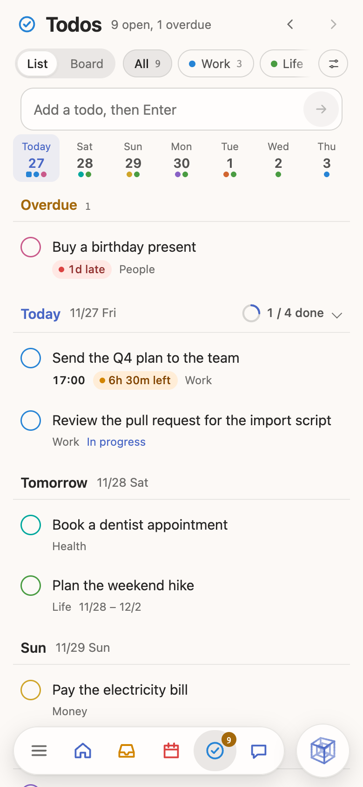

# Zirma

An open-source personal agent for your tasks, calendar, mail, notes and code. It runs on a computer you control and shares one workspace with you: you both see the same todos, the same calendar and the same pages, and what it would change outside Zirma, such as a calendar event or a reply, waits for your yes.

**[zirma.dev](https://zirma.dev)** · [Architecture](docs/ARCHITECTURE.md) · [Design docs](docs/design/README.md) · [Develop](#develop)

<picture>
  <source media="(prefers-color-scheme: dark)" srcset="docs/media/todos-dark.png">
  
</picture>

**Status: early (0.1.x).** Zirma is in daily use by its author and changes every week. There is no signed download yet: you run it from source, or build the Mac app yourself. Everything in the screenshots is sample data.

## What it does

- **Today.** One page that says what is next: the day's events, what is due, what is waiting on you.
- **Todos, Calendar, Mail.** Todos by day or as a board, in areas you define. Google Calendar and Gmail are read in; an event Zirma wants to add or a reply it wants to send is a proposal you accept, change or decline.
- **Notes.** Pages inside pages, kept as plain Markdown in a folder on your disk, with tables, callouts, to-dos and a history per page.
- **Links.** What you saved from the web, in categories, with one search across all of it.
- **Chats.** Ask in a sentence from any page. Each conversation keeps its own session and model, and you can add to a run while it works.
- **Automations.** Things that happen on a schedule, such as a morning brief written before you sit down.
- **Code.** A second mode for development: projects, sessions in their own git worktree, your terminal beside the conversation, and a permission mode you choose.
- **Voice.** Dictate into any field, or hold a key and say it; Zirma can answer aloud.
- **Every device.** Pair a phone or a laptop and open the same workspace there. A notice goes to the one device you are using.
- **Your own tools.** Sign in to the model you want to use, and add MCP servers and skills, all in Settings.

A note is a page of Markdown with pages inside it:

<picture>
  <source media="(prefers-color-scheme: dark)" srcset="docs/media/notes-dark.png">
  
</picture>

Links, and the same workspace on a phone:

<p>
  <picture><source media="(prefers-color-scheme: dark)" srcset="docs/media/links-dark.png"></picture>
  <picture><source media="(prefers-color-scheme: dark)" srcset="docs/media/phone-dark.png"></picture>
</p>

## How it is put together

One **home node** on your computer holds your world: what you asked for, what got done, and the proof that it got done. The Mac app, a browser tab and your phone are windows onto that same node. Closing a window stops nothing; the node keeps working and starts again at login.

- **A sentence becomes a run.** Submitting one returns at once; the conversation never blocks while a run works.
- **Results are backed by receipts:** the events a run actually wrote, recorded in the same transaction as each change. If the model says "done" but called no tool, the run has no receipts.
- **Retries are safe.** Every command and run carries a request id; sending it again returns the first result.
- **A crash never repeats work.** A run cut off in the middle comes back marked *interrupted* and runs again only if you continue it.
- **You decide what a tool may do.** Tools that only read run freely. Any other tool call asks you first, for that one call, and if you say no the assistant is told not to try another way. Deleting for good always asks.
- **The node listens only on this machine.** Other devices reach it over your own Tailscale network after pairing with a one-time code, and you can remove a device at any time.

The full design is in [docs/ARCHITECTURE.md](docs/ARCHITECTURE.md).

## Run it

You need a Mac and Node 24 or newer. (The home node also runs on Linux; the app is Mac only.)

```bash
git clone https://github.com/bruceche-cmu-F25/Zirma.git
cd Zirma
npm install
npm run desktop
```

On first open, the app installs the home node as a launchd user agent and shows a short walkthrough; each step can be skipped and done later in Settings. Connect a model in Settings → Models and, for Calendar and Mail, a Google account in Settings → Accounts. Without a model, the pages still work by hand.

- Run from source, macOS shows the app as "Electron".
- `⌥Space` opens Zirma from anywhere. The figure in the corner of the screen shows when Zirma is working or has something waiting.
- To build `Zirma.app` and a disk image: `npm run package:mac`. The build is ad hoc signed, not notarized: on another Mac, open it the first time with right-click → Open. See [docs/packaging.md](docs/packaging.md).

To run only the home node and use it in a browser:

```bash
npm start          # builds the interface, then serves http://127.0.0.1:7491
```

**Development and production never share anything.** Anything run from this source tree is development; production is the installed Zirma.app.

| | Production (Zirma.app) | Development (from source) |
|---|---|---|
| World | `~/Library/Application Support/Zirma/` | `~/Library/Application Support/Zirma Dev/` |
| Port | 7480 | 7491 |
| launchd agent | `zirma.home-node` | `zirma.home-node.dev` |
| Keychain service | `Zirma` | `Zirma Dev` |

To remove the development background service:

```bash
launchctl bootout gui/$(id -u)/zirma.home-node.dev; rm ~/Library/LaunchAgents/zirma.home-node.dev.plist
```

## Develop

```bash
npm test             # every package and module, including a kill-mid-run test
npm run typecheck
npm run trial        # a throwaway node on a fresh temporary world, port 7520
npm run dev:ui       # the interface with hot reload on :5173, talking to the trial node
npm run prototype    # the clickable design prototypes on :4173
```

Read [AGENTS.md](AGENTS.md) before the first command and [docs/WORKFLOW.md](docs/WORKFLOW.md) before the first branch: one branch per task cut from `zirma`, merged back by a squash-merged pull request. A large feature starts as a design doc in [docs/design/](docs/design/README.md).

```text
packages/core        the world (events, state), runs, notices, attention, settings
packages/module-kit  the module contract: operations, agent tools, permission levels
packages/engine-pi   runs one run as a tool-scoped agent session; MCP servers and skills
packages/server      the home node: HTTP + SSE, pairing, voice, web access, the CLI
packages/protocol    the public client protocol types
packages/ui          the interface every device opens (React + Vite), and the figure
packages/desktop     the Mac app (Electron): launchd home node, figure, menu bar, hotkeys
modules/             todo, calendar, mail, links, notes: each one a module on the kit
prototype/           clickable studies made before a feature is built
docs/                architecture, design docs, research, workflow
```

## The name

Zirma (say ZEER-ma) is a city in Italo Calvino's *Invisible Cities*. You talk with one of two characters, **Ana** or **Kata**, named for the two directions of the fourth dimension; pick one, or give it a name of your own, in Settings → General. The app was called Alfred, then Isocline, until November 2026; an older install moves its data over by itself the first time the new app opens.

## Licence

MIT. Zirma builds on [Pi](https://github.com/earendil-works/pi) (MIT, © Mario Zechner) and borrows code and designs from [pi-web](https://github.com/agegr/pi-web) (MIT, © agegr), among others: see [THIRD-PARTY-NOTICES.md](THIRD-PARTY-NOTICES.md).
